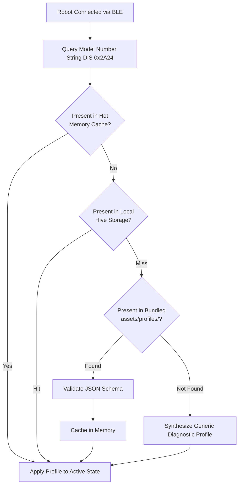

# AIR Robotics Mobile Application

[](https://flutter.dev)
[]()
[-orange.svg)]()
[]()
[]()

**AIR Robotics** is a universal, high-performance, cross-platform mobile companion platform built with **Flutter (Dart 3)** for controlling robots wirelessly over Bluetooth Low Energy (BLE).

Rather than building isolated, single-use mobile applications for individual robots, AIR Robotics operates as a **generic, profile-driven mobile companion**. The app discovers, connects to, and controls any robot speaking the **AIR Robotics BLE protocol** (`0000FAB0-...`). Each robot dynamically binds via a declarative **Device Profile** that specifies available actuators, telemetry channels, command sets, and dynamic UI layouts.

The primary reference implementation targets the **Fabrica Cloth Folding Robot** (`fabrica-devkit-v1`), an ESP32-powered automated garment folder featuring four articulated folding panels, tactile preset buttons, and real-time kinematic telemetry.

---

## Key Features & Highlights

- **Universal & Profile-Driven Architecture**: Robot models identify themselves over the standard BLE Device Information Service (`0x180A`, DIS `0x2A24`). The app dynamically instantiates tailored control surfaces, telemetry decoders, and UI dashboards from on-device profile definitions.
- **Enterprise-Grade BLE Transport**: Powered by `flutter_blue_plus`, supporting 120-second "Hold-to-Pair" physical gating, SMP "Just Works" LE Secure Connections bonding, automatic reconnection across 15-minute Resolvable Private Address (RPA) rotations, and MTU auto-negotiation up to 517 bytes.
- **Ultra-Low Latency & High Frame-Rate Telemetry**: Zero-allocation 31-byte Little-Endian binary telemetry unpacking at 10 Hz during active motion (throttled to 1 Hz in idle), driving hardware-accelerated 60/120 fps animations.
- **Fail-Safe Fast-Path Emergency Stop**: Hard safety interlock (`CMD_EMERGENCY_STOP` / `0x03`) dispatched directly via `Write Without Response`, bypassing intermediate queues to guarantee $<50\text{ ms}$ abort latency on physical hardware.
- **100% Offline-First by Design**: Completely self-contained for workshops, makerspaces, and home environments using a 4-tier profile resolution waterfall (Memory $\to$ Local Storage $\to$ Bundled Asset $\to$ Generic Fallback).
- **Interactive Kinematic Visualizer**: Hardware-accelerated Flutter `CustomPainter` canvas (`fabrica-flap-grid`) rendering smooth real-time 2D planar flap articulation with touch-drag servo calibration.
- **Visual Sequence Builder & Flash Manager**: Multi-step folding sequence editor featuring stateless real-time preview (`0x01`) and 1-tap NVS flash persistence (`0x0A`) with deterministic IEEE 802.3 CRC32 verification.

---

## Architecture Overview

```mermaid
graph TD
    subgraph BLE_Hardware [AIR Robotics BLE Hardware Ecosystem]
        ESP32[ESP32 Robot Controller<br/>GATT Server: Base FAB0]
    end

    subgraph Flutter_Client [AIR Robotics Mobile Application (Flutter)]
        subgraph Transport_Core [1. Universal BLE Transport Layer]
            SCANNER[BLE Discovery & RSSI Filter]
            SECURITY[SMP Bonding & RPA Resolver]
            GATT[GATT Client & MTU 517B Handler]
            AUTO_RECONNECT[Exponential Backoff Reconnect]
        end

        subgraph Protocol_Bus [2. Protocol Codec & Telemetry Bus]
            BINARY_DECODER[Zero-Copy 31B Struct Decoder]
            TELEM_STREAM[10 Hz / 1 Hz Reactive Stream]
            CMD_PIPELINE[Command Serializer & E-Stop Fast-Path]
            CRC32_ENGINE[IEEE 802.3 CRC32 Engine]
        end

        subgraph Profile_Engine [3. On-Device Profile Runtime]
            PROFILE_RESOLVER[On-Device Profile Resolver]
            SCHEMA_VALIDATOR[JSON Schema Validator]
            LOCAL_STORAGE[(Hive Storage & User Routines)]
            BUNDLED_ASSETS[Pre-Bundled Asset Profiles<br/>assets/profiles/*.json]
        end

        subgraph UI_Engine [4. Dynamic SDUI & Presentation]
            DYNAMIC_SCAFFOLD[Adaptive Screen & Tab Scaffold]
            WIDGET_CATALOG[Dynamic Widget Catalog<br/>Banners, Presets, Sliders, E-Stop]
            CANVAS_REGISTRY[Pluggable Canvas Registry]
            FABRICA_CANVAS[Fabrica 2D Flap Visualizer<br/>CustomPainter 60fps Interactive]
        end
    end

    ESP32 <-->|DIS 0x180A + FAB0 Service| GATT
    GATT --> BINARY_DECODER
    CMD_PIPELINE -->|FAB1 Write| GATT
    BINARY_DECODER --> TELEM_STREAM
    TELEM_STREAM --> WIDGET_CATALOG
    TELEM_STREAM --> FABRICA_CANVAS
    PROFILE_RESOLVER --> LOCAL_STORAGE
    PROFILE_RESOLVER --> BUNDLED_ASSETS
    PROFILE_RESOLVER --> SCHEMA_VALIDATOR
    PROFILE_RESOLVER --> DYNAMIC_SCAFFOLD
    DYNAMIC_SCAFFOLD --> WIDGET_CATALOG
    CANVAS_REGISTRY --> FABRICA_CANVAS
    WIDGET_CATALOG --> CANVAS_REGISTRY
```

---

## BLE Protocol & GATT Topology

AIR Robotics devices communicate over a standard GATT architecture:

### 1. Device Information Service (`0x180A`)
- **Model Number String (`0x2A24`)**: Identifies robot hardware model (e.g. `"Fabrica-DevKit-v1"`).
- **Firmware Revision (`0x2A26`)**: Semantic versioning string (e.g. `"v1.13.0"`).
- **Manufacturer Name (`0x2A29`)**: Verified against `"AIR Robotics"` or authorized partners.

### 2. Primary AIR Robotics Service (`0000FAB0-0000-1000-8000-00805F9B34FB`)

| Characteristic | Short UUID | 128-Bit UUID | Properties | Purpose |
| :--- | :--- | :--- | :--- | :--- |
| **Control Point** | `FAB1` | `0000FAB1-0000-1000-8000-00805F9B34FB` | `Write`, `Write Without Response` | Motion triggers, raw preview, calibration jog, and Emergency Stop |
| **Telemetry Stream** | `FAB2` | `0000FAB2-0000-1000-8000-00805F9B34FB` | `Read`, `Notify` | Real-time packed 31-byte binary packet (10 Hz active, 1 Hz idle) |
| **Configuration** | `FAB3` | `0000FAB3-0000-1000-8000-00805F9B34FB` | `Read`, `Write`, `Notify` | 212-byte table of all 4 physical button presets with CRC32 |

### 3. Binary Telemetry Packet Layout (`FAB2`)

Incoming notification frames from `FAB2` are parsed with zero allocations using Dart `ByteData`:

```
Byte Offset:   0  1  2  3  4  5 [6-7] [8 .. 23]  24 [25-26] 27 28 [29-30]
Field:        [S][L][B][I][T][P][ELAP] [ANGLES] [ST] [HEAP] [R][E] [SEQ ]
```

| Offset | Length | Field | Type | Description |
| :---: | :---: | :--- | :--- | :--- |
| **0** | 1B | `system_state` | `uint8` | `0` = IDLE, `1` = RUNNING_MOTION, `2` = ESTOP, `3` = ERROR, `4` = CALIBRATING |
| **1** | 1B | `led_state` | `uint8` | `0` = IDLE, `1` = RUNNING, `2` = SAVE_SUCCESS, `3` = INPUT_ERROR, `4` = ESTOP, `5` = PAIRING, `6` = CONNECTED, `7` = IDENTIFY |
| **2** | 1B | `active_button_id` | `uint8` | Active preset slot (`1–4`), or `0` for raw preview / idle |
| **3** | 1B | `current_step_idx` | `uint8` | 0-based active step index (`0–15`) |
| **4** | 1B | `total_steps` | `uint8` | Total steps in active routine (`0–16`) |
| **5** | 1B | `step_progress_pct` | `uint8` | Step sweep completion percentage ($0\% \text{ to } 100\%$) |
| **6–7** | 2B | `elapsed_step_time_ms` | `uint16` (LE) | Elapsed time in active step (milliseconds) |
| **8–23** | 16B | `channel_angles` | `uint8[16]` | Commanded angles ($0^\circ \text{ to } 180^\circ$) across 16 servo channels |
| **24** | 1B | `last_cmd_status` | `uint8` | `0` = OK, `1` = BUSY, `2` = INVALID_STEP, `3` = MOTOR_BOUNDS, `4` = ROUTINE_FULL, `5` = CRC_MISMATCH, `6` = INVALID_ARG |
| **25–26** | 2B | `free_heap_kb` | `uint16` (LE) | Free ESP32 internal SRAM in KB |
| **27** | 1B | `ble_rssi_dbm` | `int8` | Central connection RSSI in dBm (signed int8) |
| **28** | 1B | `error_code` | `uint8` | Fault bitmask (`BIT0` = I2C Fault, `BIT1` = NVS Fault, `BIT2` = E-Stop Active) |
| **29–30** | 2B | `sequence_counter` | `uint16` (LE) | Monotonically increasing counter for dropped frame tracking |

---

## On-Device Profile Resolution (Phase 1)

Profiles are resolved entirely on-device through a resilient 4-tier waterfall:



1. **Tier 1 — Hot In-Memory Cache**: Instant hot lookup ($<1\text{ ms}$) for the active robot profile.
2. **Tier 2 — Local Persistence (Hive)**: Stores user customizations, custom presets, and mechanical trims offline.
3. **Tier 3 — Pre-Bundled Asset Profiles**: Static JSON definitions shipped directly with the app binary under `assets/profiles/` (e.g. `fabrica-devkit-v1.json`). Validated against `air-device-profile.schema.json`.
4. **Tier 4 — Generic Diagnostic Fallback**: Auto-generated fallback UI providing 16 generic slider channels, E-Stop, and raw hex console if an unrecognized model connects.

---

## Technology Stack

| Layer | Technology | Details |
| :--- | :--- | :--- |
| **Framework** | Flutter (v3.19+ / v3.22+) | Cross-platform GPU-accelerated UI framework (Impeller / Skia) |
| **Language** | Dart 3.x | Sound null-safety, pattern matching, records, zero-allocation buffers (`ByteData`) |
| **Platforms** | iOS 14.0+ & Android 8.0+ (API 26+) | Universal smartphone deployment |
| **BLE Transport** | `flutter_blue_plus` (v1.32+) | Industrial native bindings for iOS CoreBluetooth and Android BluetoothGatt |
| **State Management** | Flutter Riverpod (v2.5+) | Compile-safe state graphs, reactive streams (`StreamProvider`) |
| **Local Storage** | Hive / `hive_flutter` | High-speed NoSQL document & key-value offline storage |
| **Schema Validation** | `json_schema` (v5.1+) | Validates on-device profile structures at runtime |
| **Data Models & Codec** | Freezed & `json_serializable` | Immutable models, union types, and serialization |
| **Data Integrity** | IEEE 802.3 CRC32 | Deterministic pure-Dart CRC32 engine (`0xEDB88320` polynomial) |
| **Kinematic Canvas** | Flutter `CustomPainter` | 60/120 fps hardware-accelerated 2D planar projection rendering |
| **Telemetry Charts** | `fl_chart` (v0.66+) | Real-time motor trajectory and angle strip charts |

---

## Project Structure

```
air-robotics-app/
├── README.md                      # Project root documentation
├── specs/                         # Architecture, mission & technical specifications
│   ├── mission.md                 # Core mission, principles & target audience
│   ├── tech-stack.md              # Detailed toolchain, protocol specs & GATT topology
│   └── roadmap.md                 # Phased engineering milestones & validation criteria
├── assets/                        # Static application assets
│   ├── profiles/                  # Pre-bundled on-device robot profiles
│   │   ├── air-device-profile.schema.json  # JSON schema for profile validation
│   │   └── fabrica-devkit-v1.json          # Reference Fabrica profile
│   └── icons/                     # Vector icons & branding assets
├── lib/                           # Flutter application source code (Phase 1+)
│   ├── core/                      # Reusable core subsystems
│   │   ├── ble/                   # BLE transport, scanning, SMP bonding & GATT client
│   │   ├── protocol/              # Binary codecs, CRC32, packet decoders & command pipeline
│   │   ├── profile/               # Profile loader, schema validator & registry
│   │   └── theme/                 # Dark mode safety theme & design tokens
│   ├── ui_engine/                 # Dynamic presentation engine
│   │   ├── dynamic_screen_scaffold.dart    # Profile-driven adaptive screen router
│   │   └── widget_catalog/        # Status banner, jog sliders, preset grid, E-Stop
│   ├── visualizers/               # Kinematic canvas registry
│   │   └── fabrica/               # Fabrica 2D Flap CustomPainter visualizer
│   └── main.dart                  # Application entry point
└── test/                          # Unit, widget, and integration test suite
```

---

## Roadmap & Milestones

- [x] **Phase 0 — Project Constitution & Mobile Specs**: Architecture specifications, protocol definitions, and Fabrica reference profile mapping.
- [ ] **Phase 1 — Project Skeleton, Core Theming & Protocol Models**: Flutter scaffolding, high-contrast dark theme, zero-allocation 31-byte telemetry decoder, and CRC32 engine.
- [ ] **Phase 2 — Universal BLE Transport, Scanning, Hold-to-Pair & SMP Bonding**: Bluetooth scanning, RSSI smoothing, 120s pairing window gating, LE Secure Connections bonding, RPA auto-reconnect, and MTU 517B exchange.
- [ ] **Phase 3 — Binary Telemetry Bus & Real-Time Command Pipeline**: Reactive `StreamProvider` telemetry bus, drop detection, command dispatcher, and $<50\text{ ms}$ fast-path E-Stop.
- [ ] **Phase 4 — Dynamic Profile Engine, JSON Schema Validator & Local Storage**: JSON Schema validator, Hive profile caching, offline storage, and generic diagnostic fallback.
- [ ] **Phase 5 — Dynamic SDUI Renderer & Standard Widget Catalog**: Profile-driven dynamic screen scaffold, status banner, jog slider bank, preset grid, and raw hex console.
- [ ] **Phase 6 — Fabrica Reference Implementation: 2D Flap Canvas, Sequencer & E2E Validation**: Interactive 60 fps `CustomPainter` flap grid, timeline folding sequencer, NVS flash commit, and physical ESP32 hardware validation.
- [ ] **Phase 7+ (Future Expansion) — Cloud Profile Registry**: Over-the-air community profile distribution via `registry.air-robotics.org`.

For comprehensive milestone details and acceptance criteria, refer to [specs/roadmap.md](specs/roadmap.md).

---

## Getting Started

### Prerequisites

- **Flutter SDK**: v3.19.0 or higher ([Install Flutter](https://docs.flutter.dev/get-started/install))
- **Dart SDK**: 3.x (bundled with Flutter)
- **Xcode** (for iOS): v15.0+ with iOS 14.0+ deployment target
- **Android Studio** (for Android): Android SDK API 34+ with minimum SDK 26 (Android 8.0)
- **Physical BLE Test Hardware**: An ESP32 development board running the Fabrica cloth folder firmware or compatible AIR Robotics GATT peripheral (physical device required for Bluetooth testing; iOS/Android emulators do not support peripheral BLE connections).

### Installation & Build

1. **Clone the repository**:
   ```bash
   git clone https://github.com/air-robotics/air-robotics-app.git
   cd air-robotics-app
   ```

2. **Install Flutter dependencies**:
   ```bash
   flutter pub get
   ```

3. **Run code generation** (Freezed & JSON serializable):
   ```bash
   dart run build_runner build --delete-conflicting-outputs
   ```

4. **Run unit tests**:
   ```bash
   flutter test
   ```

5. **Launch the application**:
   ```bash
   # Run on connected physical iOS or Android device
   flutter run
   ```

---

## BLE Permissions

### Android (`android/app/src/main/AndroidManifest.xml`)
```xml
<uses-permission android:name="android.permission.BLUETOOTH" android:maxSdkVersion="30" />
<uses-permission android:name="android.permission.BLUETOOTH_ADMIN" android:maxSdkVersion="30" />
<uses-permission android:name="android.permission.ACCESS_FINE_LOCATION" android:maxSdkVersion="30" />
<uses-permission android:name="android.permission.BLUETOOTH_SCAN" android:usesPermissionFlags="neverForLocation" />
<uses-permission android:name="android.permission.BLUETOOTH_CONNECT" />
```

### iOS (`ios/Runner/Info.plist`)
```xml
<key>NSBluetoothAlwaysUsageDescription</key>
<string>AIR Robotics requires Bluetooth access to discover, pair with, and control your robot.</string>
<key>NSBluetoothPeripheralUsageDescription</key>
<string>AIR Robotics connects to robot hardware over Bluetooth Low Energy.</string>
```

---

## Detailed Documentation & Firmware Reference

- **[Mission & System Specification](specs/mission.md)**: Product purpose, core invariants, target audience, and architectural requirements.
- **[Technology Stack & Architecture](specs/tech-stack.md)**: Detailed toolchain, GATT topology, 31-byte telemetry layout, and safety design.
- **[Development Roadmap](specs/roadmap.md)**: Phase-by-phase implementation plan, component breakdowns, hardware testing milestones, and firmware file mapping.
- **Authoritative ESP32 Firmware**: Live firmware source code is maintained at `/Users/intelligentmachine/workspace/fabrica/firmware` (BLE transport, packet layouts, motion sweeps, and storage). Consult this codebase when implementing protocol decoders, command opcodes, and Fabrica UI visualizers.

