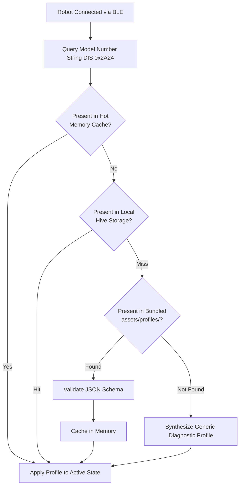

# Tech Stack — AIR Robotics Mobile Application

## 1. Platform Toolchain & Core Technology Stack

| Layer | Tool / Standard | Details |
| :--- | :--- | :--- |
| **Application Name** | **AIR Robotics** | Generic robotics mobile companion platform |
| **Framework / SDK** | Flutter (v3.19+ / v3.22+) | High-performance, cross-platform UI framework with Impeller/Skia GPU rendering |
| **Language Standard** | Dart 3.x | Sound null safety, pattern matching, records, and zero-allocation typed data buffers (`ByteData`, `Uint8List`) |
| **Target Mobile Platforms** | iOS 14.0+ & Android 8.0+ (API 26+) | Universal smartphone deployment covering 99%+ of active mobile devices |
| **Wireless BLE Driver** | `flutter_blue_plus` (v1.32+) | Production-hardened native bindings for iOS CoreBluetooth and Android BluetoothGatt |
| **Reactive State Engine** | Flutter Riverpod (v2.5+) | Compile-safe, testable state trees with first-class reactive stream integration (`StreamProvider`) |
| **Local Offline Storage** | Hive / `hive_flutter` | Ultra-fast, lightweight NoSQL document and key-value storage for cached profiles and offline sequences |
| **Profile Storage (Phase 1)**| On-Device Asset Bundles | Zero-latency local JSON profiles pre-bundled in `assets/profiles/` (100% offline) |
| **Schema Validation** | `json_schema` (v5.1+) | Validates on-device profiles against the AIR Robotics JSON Schema draft at runtime |
| **Data Modeling & Codec** | Freezed & `json_serializable` | Immutable data classes, union types, pattern matching, and JSON serialization |
| **Data Integrity Engine** | IEEE 802.3 CRC32 | Pure Dart implementation of standard CRC32 (`0xEDB88320` polynomial) matching ESP32 NVS verification |
| **High-Performance Canvas** | Flutter `CustomPainter` | Hardware-accelerated 60/120 fps canvas rendering for kinematic robot visualizers (Fabrica Flap Grid) |
| **Diagnostics & Telemetry** | `fl_chart` (v0.66+) | Real-time hardware telemetry strip charts and trajectory tracking |

---

## 2. End-to-End Application Architecture

```mermaid
graph TD
    subgraph Physical_Hardware [Physical Robotics Hardware]
        ESP32[ESP32 Robot Controller<br/>GATT Server: Base FAB0]
    end

    subgraph Native_Layer [OS Native Bluetooth Layer]
        CB[iOS CoreBluetooth / Android BluetoothGatt]
    end

    subgraph Mobile_App [AIR Robotics Mobile Application Platform]
        subgraph Core_BLE [Core BLE Transport Subsystem]
            SCANNER[BLE Scanner & RSSI Smoother]
            SMP[SMP Just Works Bonding & RPA Privacy]
            GATT_CLIENT[GATT Client & 517B MTU Manager]
            RECONNECT[Exponential Backoff Auto-Reconnect]
        end

        subgraph Protocol_Bus [Protocol Codec & Telemetry Bus]
            DECODER[Zero-Copy 31B Struct Decoder]
            TELEM_BUS[10 Hz / 1 Hz Reactive StreamProvider]
            CMD_PIPELINE[Command Serializer & Dispatcher]
            ESTOP_FAST[Fast-Path E-Stop Bypass Queue (<50ms)]
            CRC32_CALC[IEEE 802.3 CRC32 Engine]
        end

        subgraph Profile_Subsystem [Device Profile Runtime (On-Device)]
            PROFILE_MGR[On-Device Profile Resolution Manager]
            STORAGE_TIER[(Hive Local Storage & User Routines)]
            BUNDLE_TIER[Bundled Asset Profiles<br/>assets/profiles/*.json]
            SCHEMA_VAL[JSON Schema Validator]
        end

        subgraph SDUI_Presentation [Dynamic SDUI & Presentation Subsystem]
            DYNAMIC_ROUTER[Adaptive Screen & Tab Router]
            WIDGET_FACTORY[Dynamic Widget Factory]
            STD_CATALOG[Standard Widget Catalog<br/>Status, Presets, Sliders, E-Stop]
            CANVAS_REGISTRY[Pluggable Canvas Registry]
            FABRICA_CANVAS[Fabrica 2D Flap Visualizer<br/>CustomPainter 60fps Native]
        end
    end

    ESP32 <-->|RF Link| CB
    CB <--> Core_BLE
    Core_BLE --> DECODER
    DECODER --> TELEM_BUS
    CMD_PIPELINE -->|FAB1 Write| Core_BLE
    ESTOP_FAST -->|FAB1 Write Without Response| Core_BLE
    PROFILE_MGR --> STORAGE_TIER
    PROFILE_MGR --> BUNDLE_TIER
    PROFILE_MGR --> SCHEMA_VAL
    PROFILE_MGR --> DYNAMIC_ROUTER
    DYNAMIC_ROUTER --> WIDGET_FACTORY
    WIDGET_FACTORY --> STD_CATALOG
    WIDGET_FACTORY --> CANVAS_REGISTRY
    CANVAS_REGISTRY --> FABRICA_CANVAS
    TELEM_BUS --> STD_CATALOG
    TELEM_BUS --> FABRICA_CANVAS
```

---

## 3. BLE Protocol & GATT Architecture

All AIR Robotics-compatible robots implement a standardized GATT hierarchy that AIR Robotics interfaces with natively:

### 3.1 Standard Device Information Service (`0x180A`)
Upon initial connection, AIR Robotics queries the standard DIS to resolve on-device profile binding:
- **Model Number (`0x2A24`)**: Primary key used for on-device profile matching (e.g. `"Fabrica-DevKit-v1"`).
- **Firmware Revision (`0x2A26`)**: Semantic versioning string (e.g. `"v1.13.0"`) used for protocol feature gating.
- **Manufacturer Name (`0x2A29`)**: Verified against `"AIR Robotics"` or authorized partners.

### 3.2 Primary AIR Robotics Service Topology (`0000FAB0-0000-1000-8000-00805F9B34FB`)

| Characteristic | Short UUID | 128-Bit UUID | Properties | Purpose |
| :--- | :--- | :--- | :--- | :--- |
| **Control Point** | `FAB1` | `0000FAB1-0000-1000-8000-00805F9B34FB` | `Write`, `Write Without Response` | Command ingress for routine triggers, raw preview, calibration jog, E-Stop, and factory resets (`0x00`–`0x1F`) |
| **Telemetry Stream**| `FAB2` | `0000FAB2-0000-1000-8000-00805F9B34FB` | `Read`, `Notify` | Real-time packed 31-byte binary packet (10 Hz in motion, 1 Hz idle) |
| **Configuration** | `FAB3` | `0000FAB3-0000-1000-8000-00805F9B34FB` | `Read`, `Write`, `Notify` | 212-byte table of all 4 physical button folding routines with auto-CRC32 |

### 3.3 Command Opcode Wire Reference (`FAB1`)

All commands targeting `FAB1` are serialized as Little-Endian byte arrays:

| Opcode | Command Name | Payload Structure | Write Mode | Firmware Behavior |
|---|---|---|---|---|
| `0x00` | `CMD_RUN_PRESET` | `[0x00, preset_id (1-4)]` (2B) | With/Without Rsp | Executes saved preset from flash; streams 10 Hz telemetry; rejected if busy. |
| `0x01` | `CMD_RUN_RAW_SEQUENCE` | `[0x01, step_count, (motor_count, m0, m1)...]` or `[0x01][53B struct]` | With/Without Rsp | Executes routine from RAM without modifying flash (`active_button_id = 0`). |
| `0x02` | `CMD_STOP_SEQUENCE` | `[0x02]` (1B) | Without/With Rsp | Halts motion, homes flaps to $0^\circ$. **Unlatches** `STATE_ESTOP`, resets error bit 2, returns to `STATE_IDLE_RUN`. Exits calibration mode. |
| `0x03` | `CMD_EMERGENCY_STOP` | `[0x03]` (1B) | **Without Response** ($<50\text{ms}$) | Halts motion immediately, homes all 16 servos to $0^\circ$, flashes LED, latches `STATE_ESTOP` (bit 2). |
| `0x0A` | `CMD_SET_BUTTON_SEQUENCE` | `[0x0A, preset_id, step_count, steps...]` | With/Without Rsp | Calculates CRC32, commits routine to flash slot (1-4), pulses LED 2s, pushes 212B on `FAB3`. |
| `0x0B` | `CMD_GET_BUTTON_CONFIG` | `[0x0B]` (1B) | With/Without Rsp | Triggers an immediate 212-byte GATT notification push over `FAB3` with all 4 button routines. |
| `0x0C` | `CMD_RESTORE_FACTORY_PRESETS`| `[0x0C]` (1B) | With/Without Rsp | Restores hardcoded default presets 1–4, homes servos to $0^\circ$, emits 212B notification on `FAB3`. Leaves BLE bonds intact. |
| `0x0D` | `CMD_JOG_MOTOR_ANGLE` | `[0x0D, channel (0-15), angle (0-180)]` (3B) | **Without Response** | Sets live servo angle for manual positioning. Protected by 10s thermal PWM cutoff and 15s inactivity auto-home. |
| `0x0E` | `CMD_IDENTIFY_ROBOT` | `[0x0E]` (1B) | Without/With Rsp | Triggers a 3-second rapid visual LED pulse train (`LED_STATE_IDENTIFY`) for physical locator identification. |
| `0x10` | `CMD_GET_TELEMETRY` | `[0x10]` (1B) | With/Without Rsp | Requests a single-shot 31-byte telemetry notification on `FAB2`. |
| `0x11` | `CMD_SET_TELEMETRY_STREAM` | `[0x11, enable (0 or 1)]` (2B) | With/Without Rsp | Pauses (`0x00`) or resumes (`0x01`) continuous background telemetry streaming on `FAB2`. |
| `0x1F` | `CMD_FACTORY_RESET_ALL` | `[0x1F]` (1B) | With Response | **Full System Reset**: wipes custom routines, homes all servos, **erases all bonded phone keys (LTKs/IRKs) from NVS flash**, terminates BLE connection, and restarts pairing mode. |

### 3.3 Packed 31-Byte Telemetry Wire Layout (`FAB2`)

Incoming notification bytes from `FAB2` are parsed with zero memory allocations via Dart `ByteData`:

```
Byte Offset:   0  1  2  3  4  5 [6-7] [8 .. 23]  24 [25-26] 27 28 [29-30]
Field:        [S][L][B][I][T][P][ELAP] [ANGLES] [ST] [HEAP] [R][E] [SEQ ]
```

| Offset | Length | Field Name | Type | Value Interpretation |
| :--- | :--- | :--- | :--- | :--- |
| **0** | 1B | `system_state` | `uint8` | `0` = IDLE, `1` = RUNNING_MOTION, `2` = ESTOP, `3` = ERROR, `4` = CALIBRATING |
| **1** | 1B | `led_state` | `uint8` | `0` = IDLE, `1` = RUNNING, `2` = SAVE_SUCCESS, `3` = INPUT_ERROR, `4` = ESTOP, `5` = PAIRING, `6` = CONNECTED, `7` = IDENTIFY |
| **2** | 1B | `active_button_id`| `uint8` | Active preset slot (`1–4`), or `0` for raw preview / idle |
| **3** | 1B | `current_step_idx` | `uint8` | 0-based active step index (`0–15`) |
| **4** | 1B | `total_steps` | `uint8` | Total steps in active routine (`0–16`) |
| **5** | 1B | `step_progress_pct`| `uint8` | Step sweep completion percentage ($0\% \text{ to } 100\%$) |
| **6–7** | 2B | `elapsed_step_time_ms`| `uint16` (LE) | Elapsed time in active step (milliseconds) |
| **8–23** | 16B | `channel_angles` | `uint8[16]` | Commanded angles ($0^\circ \text{ to } 180^\circ$) across all 16 servo channels |
| **24** | 1B | `last_cmd_status` | `uint8` | `0` = OK, `1` = BUSY, `2` = INVALID_STEP, `3` = MOTOR_BOUNDS, `4` = ROUTINE_FULL, `5` = CRC_MISMATCH, `6` = INVALID_ARG |
| **25–26**| 2B | `free_heap_kb` | `uint16` (LE) | Free internal SRAM in KB (~190–220 KB on ESP32) |
| **27** | 1B | `ble_rssi_dbm` | `int8` | Central connection RSSI in dBm (signed int8) |
| **28** | 1B | `error_code` | `uint8` | Fault bitmask (`BIT0` = I2C Fault, `BIT1` = NVS Fault, `BIT2` = E-Stop Active) |
| **29–30**| 2B | `sequence_counter` | `uint16` (LE) | Monotonically increasing packet counter for drop tracking |

---

## 4. On-Device Profile Runtime (Phase 1)

### 4.1 Local Resolution Hierarchy



1. **Tier 1 — Hot In-Memory Cache**: Zero-latency lookup ($<1\text{ ms}$) for the currently active or recently loaded robot profile.
2. **Tier 2 — Local Persistence (Hive)**: Stores user customizations, custom button assignments, and calibrated mechanical trims offline.
3. **Tier 3 — Pre-Bundled Asset Profiles (`assets/profiles/`)**: Static JSON definitions shipped directly with the app binary (e.g. `fabrica-devkit-v1.json`). Validated once on first load against the embedded JSON schema.
4. **Tier 4 — Generic Fallback**: Dynamic emergency interface synthesized on the fly with 16 generic slider channels, E-Stop, and a raw hex monitor if an unrecognized robot connects.

> **Future Cloud Migration (Phase 7+)**: An optional remote registry client (`registry.air-robotics.org`) will be introduced in a future phase to enable over-the-air profile updates for third-party community robots without requiring mobile binary updates.

---

## 5. Dynamic Presentation Engine & Design System

### 5.1 Server-Driven UI (SDUI) Widget Catalog

- **`status-banner`**: High-level system state pill, LED mode mirror, RSSI signal meter, and dismissible hardware fault banners.
- **`emergency-stop-button`**: Tactile, prominent red button dispatching `CMD_EMERGENCY_STOP` (`0x03`) via fast-path `Write Without Response` with haptic feedback.
- **`preset-grid`**: Tactile 4-button bank with one-tap trigger, circular step progress animation, and long-press sequence reprogramming.
- **`jog-slider-bank`**: Actuator calibration sliders with 50ms drag throttling to protect radio bandwidth, displaying real-time feedback angles from telemetry.
- **`timeline-sequencer`**: Multi-step folding sequence editor supporting step reordering, parallel channel flips, delay settings, stateless preview (`CMD_RUN_RAW_SEQUENCE`), and flash commit with auto-CRC32 calculation (`CMD_SET_BUTTON_SEQUENCE`).
- **`raw-hex-console`**: Engineering diagnostic tool with rolling packet log, drop rate metrics, and raw hex command injection.

### 5.2 Pluggable Native Canvas Registry

For specialized mechanical assemblies, AIR Robotics provides the `AirCustomVisualizer` registration interface:
- **`fabrica-flap-grid` Reference Visualizer**: 
  - Implemented as a hardware-accelerated Flutter `CustomPainter`.
  - Renders Left (Ch 0), Right (Ch 1), Bottom (Ch 2), and Top (Ch 3) flaps from a 2D planar projection.
  - Flaps articulate smoothly at 60 fps based on live incoming `channel_angles` telemetry.
  - Interactive touch gestures allow users to drag virtual flaps on screen to directly command physical servo positions in calibration mode.

---

## 6. Safety, Latency & Reliability Invariants

1. **Fast-Path Emergency Stop**: The Emergency Stop button dispatches directly over the radio link via `writeCharacteristicWithoutResponse()` bypassing application queues, achieving $<50\text{ ms}$ abort latency on the robot.
2. **Deterministic Sequence Checksums**: All custom sequence writes generate standard IEEE 802.3 CRC32 checksums in Dart, validated against ESP32 NVS flash verification before confirming successful programming.
3. **Battery-Aware Telemetry Throttling**: The app automatically accommodates firmware rate shifts (10 Hz during active motion, 1 Hz during idle) with rolling interpolation to prevent UI stutter while avoiding smartphone battery drain.
4. **Resilient RPA Reconnection**: Employs stored Identity Resolving Keys (`IRK`) to automatically resolve and reconnect to bonded robots as their Bluetooth MAC address rotates periodically under iOS and Android privacy protections.
5. **100% Offline Autonomy**: All profile definitions, screen layouts, and sequence editors function autonomously on-device without network connectivity.
